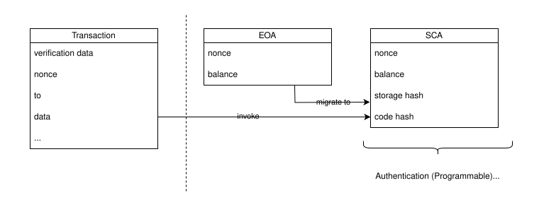
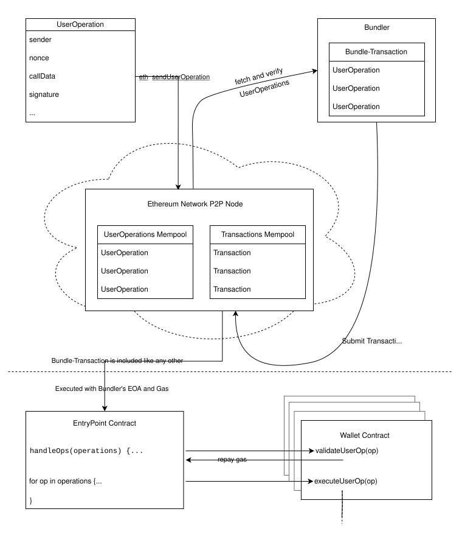

# Introducing: Ethereum Account Abstraction

<p className="text-xs text-right">February 27, 2026 by [patrickd](/about#patrickd)</p>

import { UseCases, UseCase } from '@components/usecases'
import { Callout } from 'nextra/components'
import { R, Reference, References } from '@components/references'
import { OptionalText } from '@components/optionaltext'
import { OptionTable, Option } from 'components/table'
import { Tabs } from 'nextra/components'

As you're likely aware, Ethereum has two types of accounts: Externally Owned Accounts (EOA) and Smart Contract Accounts (SCA). Transactions can only originate from EOAs, which can then invoke the execution of an SCA's code. To send a transaction, you must be in possession of an EOA's private key and the account must be sufficiently funded with Ether to pay the transaction's gas cost.

While the _effects_ of a transaction are fully programmable, the _validity conditions_ of the transaction are fixed. In other words, once you've proven that you are indeed the address's owner, your transaction will be executed causing the programmed effects, incurring a cost up to the amount that you have promised to pay for. A transaction is dismissed as invalid if its ECDSA signature-related fields (`v`, `r`, `s`, `nonce`) don't allow the recovery of an Ethereum address that is sufficiently funded to cover what was promised as maximum gas payment.


Having such fixed validity conditions for block builders is very useful, since it allows verification in constant-time and guarantees that any work done during a transaction's execution will be appropriately paid. Unfortunately, it also means that a user receiving ERC-20 tokens cannot do anything with them until he funds his address with Ether, that access to the entirety of his tokens is controlled by a single private key which must be carefully stored, and that, if he loses it by accident or to a scammer, there's little to be done in terms of recovery or revocation of access.

## Use Cases



Account Abstraction (AA) decouples the relation between _account_ and _signer_, which is causing these user experience impediments. At its best, that means there's no longer a 1-to-1 relationship between a private key and an account. Instead, there can be a variety of ways to authenticate with an account in order to act in its name and make use of the funds it holds. The following is a list of typical use cases that result in consequence of this change.

<UseCases>
  <UseCase usecase='Signature Abstraction'>
    Allows usage of custom signature schemes, instead of reliance on a single ECDSA signature for authentication.

    * **Multi-Sig**: Require $k$-out-of-$n$ valid signatures for the account to execute an action.
    * **Schnorr Signatures**: The ECDSA Scheme is basically a worse version of Schnorr Signatures, designed to be different enough so as not to infringe on Schnorr's patents. The last patent has expired in 2010 allowing us to move to the cryptographically superior signature scheme now.
    * **Quantum-Resistant Signatures**: Whether or not, and when, Quantum-Computers will become a threat to DLP-based cryptography remains to be determined, but with AA we can already switch to signature schemes that are considered resistant to their attacks.
    * **Secure-Enclave Compatible Signatures**: Ethereum uses the `secp256k1` curve for its ECDSA signatures. With AA we can make use of a signature scheme on the `secp256r1` curve, which practically allows turning any modern phone into a hardware wallet thanks to its secure enclave hardware.
    * **zk Schemes**: Zero-Knowledge-Proof schemes other than traditional signatures may be used to authenticate with the account. zkEmail, for example, allows cryptographic authentication by proving email address ownership.
  </UseCase>
  <UseCase usecase='Gas Abstraction'>
    Allows decoupling the relation between a transaction's origin and the account responsible for paying the transaction's gas cost.

    * **Pay with Tokens**: Although gas will ultimately still need to be paid in Ether, the user may acquire the necessary Ether as needed in exchange for other tokens.
    * **Gas Sponsorship**: Gas cost may be covered by sponsors, such as a DeFi project incentivizing usage of its protocol by paying (part of) its users' transactions.
    * **Private Mixer Withdrawals**: Withdrawal from a privacy mixer protocol like Tornado Cash will no longer require project-specific relayer networks or anonymously funding the withdrawal address with Ether. With AA users can pay the gas cost using part of the amount withdrawn themselves.
    * **TradFi Gas Payment**: Wallets may offer users the ability to pay their gas cost using the legacy financial system, for example, with a credit card.
  </UseCase>
  <UseCase usecase='Recovery Mechanisms'>
    Allows recovering access to an account other than having to use a securely stored seed phrase.

    * **Social Recovery**: User may appoint a set of trusted parties to recover access to an account when certain conditions have passed, such as a sufficient number of guardians collaborating.
    * **Dead Man's Switch**: User may allow a set of trusted parties to gain access to his funds after a certain time of inactivity has passed.
  </UseCase>
  <UseCase usecase='Roles & Policies'>
    Allows limiting access to an account's funds.

    * **Spending Limits**: For example, the same account may be used by multiple devices, but depending on their security they may have different spending limits.
    * **Automatic Payments**: To implement scheduled and recurring payments, third parties may be authorized to initiate transfers of certain amounts, at certain times, and under certain conditions.
    * **Delayed Execution**: A user's transaction may be time-delayed to allow timely revocation.
    * **Traditional 2FA**: Wallets may offer traditional two-factor authentication methods to restrict certain actions.
    * **Ephemeral Keys**: Allows creating temporary "session" keys that are particularly interesting for web3 games, avoiding having to constantly confirm transactions while playing.
  </UseCase>
  <UseCase usecase='Call Batching'>
    Allows the execution of multiple operations within a single transaction.

    * **Multi-Call**: A DeFi project may allow the user to plan multiple actions which are then executed within a single transaction. For example, a user may put multiple NFTs into a basket and pay them all at once.
    * **Approve & Call**: Avoid having to send separate transactions to approve tokens to a protocol, before that protocol can make use of those tokens.
    * **Batching Atomicity**: May reduce impact of transactions being sandwiched for MEV profit and allows reverting all actions if a single one fails.
  </UseCase>
  <UseCase usecase='Wallet Upgradeability'>
    Allows completely changing an account's capabilities and authentication schemes.

    * **Key Updates**: If one of the ways to access the account has been compromised, it can be disabled and replaced.
    * **Scheme Updates**: If a used authentication scheme has been compromised or has become outdated, it can be disabled and replaced.
    * **Security Updates**: Smart contract upgrades allow users to move to another, more actively maintained and secure wallet when necessary.
  </UseCase>
  <UseCase usecase='Chain Abstraction'>
    Allows seamless chain interoperability where all transaction come from the user himself.

    * **Cross-Chain Asset Transfer**: Truly decentralized, permissionless, and censorship resistant bridges.
    * **Cross-Chain Gas Abstraction**: With paymasters that get compensated without censoring abilities.
    * **Multi-Chain Execution**: Users can create transactions that operate on several chains at once.
  </UseCase>
</UseCases>

## History

Discussions on how Account Abstraction is best achieved are as old as Ethereum itself. An observable commonality in approaches is that they attempt to either teach EOAs to execute code, or SCAs to be invoked without requiring the user to have an EOA. Though ultimately, the goal has always been to eventually phase out EOAs completely by migrating them to become invocable SCAs.

There's also a notable crux issue in making a transaction's validity conditions programmable: The threat of Denial of Service (DoS) attacks on the Ethereum network by spamming it with transactions whose validation-program's execution is expensive and unpredictably invalid, causing unpaid work for block builders. Before, block builders could always rely on getting paid for spending time executing arbitrary code even if it eventually failed, because at that point it was already ensured that the EOA would have sufficient funds to pay for the gas. This is much more difficult to guarantee when the gas funding validation step itself requires code execution.

#### EIP-101

Even before its 2015 launch, the Ethereum project aimed to be as abstract as possible, to make as few assumptions as it could about how it would be used. We see this in a blogpost by Vitalik Buterin titled "On Abstraction"<R reference='1' /> which discussed how Ethereum could be agnostic about its signature scheme, data structures, and currencies. The approach it suggested was attaching a _verification code_ to EOAs which would be executed whenever a transaction was being processed. Instead of recovering a transaction's sender address from the ECDSA signature in the transaction's `v`, `r`, `s` fields, the sender is specified within a new `sender` field and a new `signature` field now carries an arbitrary byte array that is passed to the verification code.

Before, an account's address was the ECDSA public key's hash. Now, it would be the hash of the verification code attached to a transaction when the account would be first claimed. Each code hash would be unique as the code would contain the public key, though this time the key could be for any arbitrary signature scheme. To prevent DoS, the verification code would be restricted to 50,000 gas, subject to adjustments as needed.

<Callout type="info">
  You might have noticed the similarity of this approach to Bitcoin's "Pay To Script Hash" (P2SH), and indeed, Vitalik notes that it was the inspiration.
</Callout>

Four months later, these ideas were formally defined within EIP-101<R reference='2' /> where we can already see the first seeds of the "forwarding contract" idea. Transactions would have only had four fields (`to`, `startgas`, `data` and `code`) with `to` being the `sender` address, as well as the hash of the initial verification `code` to be set. The actual call's destination, the `signature`, and other information would have been moved into the `data` field. It additionally proposed moving Ether up a level of abstraction, allowing it to be treated similarly to other "sub-tokens".

#### EIP-86

<Callout>
  Note regarding numbering: EIP-101 had its number assigned due to being part of proposals belonging to the "Serenity" upgrade, though it was discussed in GitHub issue [#28](https://github.com/ethereum/EIPs/issues/28) in November 2015. On the other hand, EIP-86 had its number given based on its GitHub issue number [#86](https://github.com/ethereum/EIPs/issues/86). Due to reasons like this, the ordering of standards in this article may not always appear chronologically.
</Callout>

In January 2017, we saw another attempt at "abstracting out" signature verification and nonce checking with the introduction of EIP-86.<R reference='3' /> This time, the _verification code_ would be placed in a "forwarding contract" which is called with transaction fields `r`, `s`, `gasprice`, `nonce`, and `value` set to zero, but with the `v` field containing the chain's ID. The user would specify the forwarding contract as the transaction's recipient, while the actual transaction information (`signature`, `nonce`, `to`, `value`, `gasprice`, and `data`) is sent to it as calldata.

The forwarding contract begins with validating whatever signature scheme it implements, updates its nonce in storage, pays the miner, executes the main call the user intended, and finally requests a gas refund. To prevent DoS, miners would either use pattern matching to only allow verification codes that are known to be safe, or by restricting how much gas the verification code may consume to perform nonce and signature checks.

#### EIP-859

The same year, in November, Vitalik made a comparison<R reference='4' /> of some of the account abstraction approaches that would get rid of EOAs, by moving signature verification, gas payment, and replay protection out of the core protocol and into the EVM. The discussion resulted in an EIP draft that would have become EIP-859,<R reference='5' /> though with core devs busy trying to figure out sharding, it never matured into a merged proposal. Even so, discussions on ways to achieve account abstraction continued,<R reference='6' /> and we saw the first sophisticated _Smart Contract Wallets_ such as Gnosis Safe and Parity Multisig Wallet emerge.

In case you're curious, the improvement proposal that wasn't meant to be, used a forwarding contract, similar to EIP-86, that verified the signature, paid for gas, and executed a call to the actual destination. It differed in introducing a new transaction type, instead of setting most fields of a normal transaction to zero. It also introduced a new `PAYGAS` opcode for paying the miners with gas, instead of having to make that transfer manually. Once the transaction execution would have reached `PAYGAS`, gas payment would have been guaranteed even if the execution reverted at a later point. The proposal dropped abstracting replay protection (nonces) in favor of preserving the invariant that "each transaction can only appear once in the chain".

#### EIP-2711

In 2020, we saw several proposals that offered partial solutions to AA's use cases.

EIP-2711<R reference='7' /> would have introduced a new transaction type adding support for:

* **Sponsored Transactions** by allowing a signature to be signed by both the sender and the gas payer. By recovering the gas payer's address from the additional ECDSA signature, the gas cost would be subtracted from the sponsor's account, rather than the sender. The sender would have needed to submit their transaction to be signed by the sponsor off-chain.
* **Batch Transactions** by moving the transaction's payload into an array of child-transactions that would be executed in sequence.
* **Expiring Transactions** by adding an optional `validUntil` field that would cause the transaction to become invalid after a certain point in time.

#### EIP-2803

EIP-2803<R reference='8' /> would have introduced "Rich Transactions", where a transaction sent to a special address, one in the range reserved for precompiles, would have its call data treated as EVM bytecode and executed within the context of the signer's EOA.

#### EIP-3074

EIP-3074<R reference='9' /> proposed to introduce the `AUTH` and `AUTHCALL` opcodes, which would have temporarily delegated control of an EOA to an existing contract account. In the end, the proposal did not make it because it would have further enshrined EOAs, instead of being a step towards moving beyond them.<R reference='10' />

To delegate control of his EOA, a user would first (ECDSA) sign a message containing the contract's address, which is then passed as a function argument to the same contract. That function would invoke the `AUTH` opcode while passing it the signature, proving that the EOA's owner has indeed agreed upon giving its control to the contract.

From this point onward, within the same EVM context, that contract would be able to make external calls, equivalent to the `CALL` opcode, with `AUTHCALL`. The main difference being that `msg.sender` would be set to the EOA's address, instead of the contract's. Furthermore, any `value` sent as part of the `AUTHCALL` would be deducted from the EOA, instead of from the contract. 

#### EIP-2938

Out of all the Account Abstraction proposals that never happened, EIP-2938<R reference='11' /> was the most promising one, combining all of the learnings so far into a single coherent proposal. Specifically, it would have introduced a `PAYGAS` opcode which contracts can use to set the gas price and gas limit they're willing to pay. The opcode would also serve as an execution checkpoint, where the transaction only reverts up to the point right after it was called.

Practically, a user would send a new type of transaction containing only a `nonce`, the `target` address, and a byte array of arbitrary `data`. Lacking abstraction of replay protection, the `target` account's nonce-value would be compared against the transaction's `nonce` and incremented by one if it matched. Next, the code at `target` would be invoked and expected to execute `PAYGAS` to signal the transaction's validity within 90,000 gas.

Until `PAYGAS` is called, the contract's sole concern should have been determining whether the signature, passed within the transaction's `data`, is valid. Though it wouldn't have to be a signature, any arbitrary authentication method would work as long as it doesn't need to make use of environment opcodes, external calls, contract creations, or access to other contract's code. This restriction would be necessary to prevent a transaction from pretending to be valid off-chain, but then making use of state changes to become invalid on-chain, causing unpaid work for the network (DoS vector).

#### ERC-4337

Over time, it became clear that Account Abstraction via protocol changes (EIP) wouldn't happen any time soon, given that they're generally time intensive and most of the core developer's focus was committed to achieving Ethereum's switch to PoS. Instead, we saw ERC-4337<R reference='11' /> emerge as a proposal for introducing AA as an optional, out-of-protocol solution in September 2021, though arguably we've seen first signs of it in 2018 with Justin Drake's _Application-layer account abstraction_<R reference='12' /> post and the emergence of relay-based solutions such as the ERC-1613 Gas stations network<R reference='13' /> proposal. Since its launch in March 2023 it has been widely integrated with SCA wallets such as Safe, but overall adoption and usage still remains relatively niche compared to the total EVM account base.

Given its length, a first look at the ERC can certainly be intimidating. It declares various aspects "out of scope", leaving the reader wondering where these things are specified. Moreover, the standard has been continuously evolving with the latest changes for "v0.9" having been applied just a few months ago.<R reference='14' />



The standard introduces a new type of data object called  `UserOperation` which, similar to a transaction, is send to a peer-to-peer (P2P) network (JSON-RPC API `eth_sendUserOperation` call) of nodes keeping track of such operations in an "alternate mempool". This means that `UserOperation`s are kept track of in a mempool separate from the one keeping track of transactions, avoiding changes to Ethereum's consensus protocol.

<Tabs items={['UserOperation Fields', 'Gas Payment Fields', 'Gas Abstraction Fields']} defaultIndex="0">
  <Tabs.Tab>
    <OptionTable optionTitle="UserOperation Field">
        <Option option="sender" type="address">
        The Account making the `UserOperation`. This specifically refers to the SCA that will be triggered to execute the `UserOperation`.
        </Option>
        <Option option="nonce" type="uint256">
        Anti-replay parameter for "semi-abstracted nonce support".
        </Option>
        <Option option="factory" type="address">
        Account Factory for new Accounts OR `0x7702` flag for EIP-7702 Accounts, otherwise `address(0)`.
        </Option>
        <Option option="factoryData" type="bytes">
        Data for the Account Factory if `factory` is provided OR EIP-7702 initialization data, or empty array.
        </Option>
        <Option option="callData" type="bytes">
        The data to pass to the `sender` during the main execution call.
        </Option>
        <Option option="signature" type="bytes">
        Data passed into the `sender` to verify authorization. What it is actually used for is purposefully not defined by the standard, leaving it up to the SCA implementation.
        </Option>
    </OptionTable>
  </Tabs.Tab>
  <Tabs.Tab>
    <OptionTable optionTitle="UserOperation Field">
        <Option option="callGasLimit" type="uint256">
        The amount of gas to allocate the main execution call.
        </Option>
        <Option option="verificationGasLimit" type="uint256">
        The amount of gas to allocate for the verification step.
        </Option>
        <Option option="preVerificationGas" type="uint256">
        Extra gas to pay the bundler.
        </Option>
        <Option option="maxFeePerGas" type="uint256">
        Maximum fee per gas (similar to EIP-1559 `max_fee_per_gas`).
        </Option>
        <Option option="maxPriorityFeePerGas" type="uint256">
        Maximum priority fee per gas (similar to EIP-1559 `max_priority_fee_per_gas`).
        </Option>
    </OptionTable>
  </Tabs.Tab>
  <Tabs.Tab>
    <OptionTable optionTitle="UserOperation Field">
        <Option option="paymaster" type="address">
        Address of paymaster contract, (or empty, if the `sender` pays for gas by itself).
        </Option>
        <Option option="paymasterVerificationGasLimit" type="uint256">
        The amount of gas to allocate for the paymaster validation code (only if `paymaster` exists). Added with `EntryPoint` version v0.7, previously included in `verificationGasLimit`.
        </Option>
        <Option option="paymasterPostOpGasLimit" type="uint256">
        The amount of gas to allocate for the paymaster post-operation code (only if `paymaster` exists). Added with `EntryPoint` version v0.7, previously included in `verificationGasLimit`.
        </Option>
        <Option option="paymasterData" type="bytes">
        Data for paymaster (only if `paymaster` exists).
        </Option>
    </OptionTable>
  </Tabs.Tab>
</Tabs>

Whether nodes accept such operations is up to them, but those that do may participate in bundling multiple `UserOperations` into a single transaction, similar to how Block Builders bundle multiple transactions into a single block to be added to the chain. It should be noted that the details on the validation of user operations has changed over the various versions of the standard.


```solidity filename="IEntryPoint.sol" copy
function handleOps(PackedUserOperation[] calldata ops, address payable beneficiary);
```

All operation-bundling transactions call the `handleOps(){:solidity}` function on one of the official `EntryPoint` contracts:

| Version | Date         | Address                                      |
|---------|--------------|----------------------------------------------|
| v0.9.0  | Nov 16, 2025 | `0x433709009B8330FDa32311DF1C2AFA402eD8D009` |
| v0.8.0  | Mar 26, 2025 | `0x4337084d9e255ff0702461cf8895ce9e3b5ff108` |
| v0.7.0  | Feb 22, 2024 | `0x0000000071727De22E5E9d8BAf0edAc6f37da032` |
| v0.6.0  | Apr 24, 2023 | `0x5FF137D4b0FDCD49DcA30c7CF57E578a026d2789` |
| v0.5.0  | Mar 1, 2023  | `0x0576a174D229E3cFA37253523E645A78A0C91B57` |

Each version, being the central trusted manager of all ERC-4337 `UserOperations`, has been audited to ensure that invariants such as the following hold:

<OptionalText>

* `UserOperation` only executes if wallet validation succeeds for it.
* If wallet validation succeeds, the matching `UserOperation` must execute.
* Validations must not affect each other. All validations happen before any execution.
* If all `UserOperation`s are valid, bundler must be compensated correctly.
* Wallet only pays for valid `UserOperation`s and only if no paymaster is specified.
* Paymaster only pays if its validation of the `UserOperation` succeeds.
* If paymaster requested a `postOp`, then `postOp` must be called after the operation.
* If `postOp` reverts after a `UserOperation`, it must be called again after the `UserOperation` side effects were reverted.
* Wallet and paymaster deposits can only be withdrawn by their owner.
* Paymaster stake cannot be withdrawn if paymaster is active or during the unlock delay
* Paymaster can withdraw its stake after the unlock delay, no one else can.
</OptionalText>

The `handleOps(){:solidity}` function is passed the bundle of user operations as well as the `beneficiary` address that should receive the gas refund. The function makes two loops, the _verification loop_ and the _execution loop_. The first iterates over all operations calling `sender.validateUserOp(){:solidity}` on each, with `sender` being a SCA wallet.

```solidity filename="IAccount.sol" copy
function validateUserOp(
  PackedUserOperation calldata userOp,
  bytes32 userOpHash,
  uint256 missingAccountFunds
) external returns (uint256 validationData);
```

Aside from checking whether the `UserOperation` is valid for the given `signature` value, `validateUserOp(){:solidity}` must at least send the `missingAccountFunds` to the `EntryPoint` contract. Any Ether sent above this amount is automatically considered a deposit. Note that `EntryPoint` has a set of functions for managing Ether deposits. A sender that has deposited a sufficient amount into `EntryPoint` will receive 0 for `missingAccountFunds` and can save gas by skipping the refunds to `EntryPoint` for every `UserOperation`. 

<OptionalText>

The validation function's 32 byte return value is a packed object of either a `uint160` or an `address`, and two `uint48` values. If the `validateUserOp(){:solidity}` function successfully validated the `signature` it should set a `0` as `uint160`, a `1` otherwise. Instead of the `uint160` it can also return an `address` of an "authorizer" contract responsible for validation (if the authorizer is responsible for validating aggregated signatures it's referred to as an "aggregator"). The two `uint48` values are each 6-byte timestamps, `validUntil` and `validAfter`, respectively. The value of `validUntil` may be `0` to communicate that the `UserOperation` does not expire. Note that these values are verified by Bundlers off-chain when deciding whether to add a `UserOperation` to a bundle.

<Callout>
  Aggregators are smart contracts allowing multiple user operations to be checked by a single entity, reducing gas cost. For example, multiple BLS-signed operations can be aggregated with a single signature.
</Callout>

The standard comes with "semi-abstracted nonce support" which both guarantees `UserOperation` uniqueness, like it's guaranteed for normal transactions, while at the same time allowing SCAs to implement custom logic with regard to transaction ordering and replay protection. This is achieved by splitting the `UserOperation`'s `nonce` (256-bit) into two values `key` (192-bit) and `sequence` (64-bit). Where each arbitrarily `key` has its own sequentially and monotonically incremental `sequence` starting at `0`. Note that validation and tracking of these values is taken care of by the Bundlers and the `EntryPoint` contract, the validation function's job here is to enforce proper usage of the `key` value. In the simplest case, smart contract wallets may be completely stateless and rely on the `EntryPoint` contract's nonce handling.
</OptionalText>

Once the _verification loop_ has finished, the _execution loop_ begins calling on each `sender` for which `validateUserOp(){:solidity}` succeeded and necessary payment has been made. The call is executed using the `UserOperation`'s `callData`, meaning that there's no specific "execution function" that must be used. Though if the calldata starts with the function signature of `validateUserOp(PackedUserOperation,bytes32){:solidity}`, the rest of the `callData` will be ignored and the appropriate call will be made passing the `UserOperation` and its hash instead.

Once the SCA has finished executing the operation, the wallet is refunded the excess gas cost that was pre-charged during verification, the rest is used to reimburse the Bundler. To prevent a `UserOperation` from reserving too much gas space within a bundle, a penalty of 10% is applied on gas that remained unused if that remaining amount is $`>= 40,000`$.

With that we've walked through the entire flow following a normal ERC-4337 operation from submission to execution. The flow is slightly extended when the `UserOperation` specifies a `paymaster`, which usually either means that the operation is being sponsored (gas is payed by paymaster) or that it wants to pay for the gas cost in another way (e.g. with ERC-20 tokens). 

<OptionalText>

In that case, the _verificaton loop_ calls `paymaster.validatePaymasterUserOp(){:solidity}` _after_ `validateUserOp(){:solidity}` (which will be called with `missingAccountFunds` set to 0 in this case). Here the `paymaster` contract should check whether it really should handle payment of the current `UserOperation`, typically by validating a signature in the `paymasterData` field. If the `paymaster` contract expects being paid back in some way, it should check whether the `sender` has made sufficient funds available to it.

If the `validatePaymasterUserOp(){:solidity}` function returned a `context` (`bytes`) value, the `paymaster`'s `postOp()` function will be called and the `context` will be passed to it. As the name implies, this function is called after execution of `UserOperation` finished, successful or not. The `paymaster` should use this opportunity to deduct the appropriate amount of tokens from the `sender` for the gas that the `UserOperation` actually ended up using.

<Callout>
  The `paymaster`'s functions must be gated to only allow calls from the official `EntryPoint` contract.
</Callout>

To prevent `sender`s from cheating `paymaster`s, e.g. by using the `UserOperation` to send away the balance before it could be deducted, the effects of the `UserOperation` are reverted when `postOp()` errors. In that case, `postOp()` will be called once again in order to deduct the total final gas cost, including the extra cost incurred by the cheating attempt.

The fact that multiple `UserOperation`s may use the same `paymaster` within the same bundle offers another opportunity for a DoS attack even with its access restricted in the same manner as that of `validateUserOp(){:solidity}`. Misbehaving `paymaster`s that cause unpaid work will be throttled and eventually banned by Bundlers, ignoring `UserOperation`s that specify them. To prevent bypassing this measure using a sybil attack, a `paymaster` must stake Ether in the `EntryPoint` contract which can only been withdrawn after a delay. Note that the stake is separate from the deposit used to pay for gas fees.

<Callout>
  A discussion on factories, a contract responsible for initializing a new SCA wallet via a `UserOperation`, has been omitted here but since multiple operations may use the same factory, the same measures as for `paymaster`s apply.
</Callout>

</OptionalText>

<Callout type="info">
**Security Considerations**

1. Any functions receiving `UserOperation`s from the `EntryPoint` contract, such as `validateUserOp(){:solidity}`, `executeUserOp(){:solidity}`, or custom named execution functions, must validate that the `msg.sender` matches a trusted `EntryPoint` contract address. Note that the same is true for the functions of `paymaster` and authorizer/aggregator contracts.
1. A `factory`'s `createAccount()` function must ensure that the `msg.sender` matches the "neutral" address returned by `entryPoint.senderCreator()`. The same is true for the initialization function of an EIP-7702 delegated SCA.
1. The `userOpHash` passed to an SCA's `validateUserOp(){:solidity}` function is a hash of the entire `UserOperation` (except its `signature` field), in addition to the `EntryPoint` contract's address as well as the `chainId`. Although the `UserOperation`'s `signature` field's usage is up to the SCA's implementation, it should in some form verify this hash to prevent modification and replay of the `UserOperation`.
1. The `validateUserOp(){:solidity}` function must revert on errors, except when the issue is specifically failed authentication (i.e. an error validating the `signature` against the `userOpHash`), where it should return a `1` instead.
1. The `validateUserOp(){:solidity}` function must validate the `UserOperation`'s `nonce` enforcing which `key` is allowed to be used under what circumstance. The `nonce` consists of a `key` and a `sequence` value where the tracking and validation of each `sequence` per key is already handled outside the SCA wallet.
1. The structure of a `UserOperation` on-chain is a "packed" format where several fields are concatenated into a single one. Proper unpacking must be ensured before usage. The return value of the SCA's `validateUserOp(){:solidity}` function must be a properly "packed" structure as well.
1. Creation of SCA Wallets via a `factory` contract address, specified within the `UserOperation`, must make use of the `CREATE2` opcode to generate a wallet address that depends on the initial `signature` in order to prevent re-deployment with different credentials set to control it. 
1. Creation of SCA Wallets via a EIP-7702 initialization function should error when called multiple times for the creation of the same SCA. This may happen due to the `EntryPoint` contract being unable to tell whether an EIP-7702 account has been initiated or not.
1. Paymasters expecting a ERC-20 reimbursement should preferably obtain it during validation as transfers in `postOp()` may permanently fail and paymaster will be required to pay the transaction without reimbursement even after the user operation was reverted. Instead, use `postOp()` to return change to the user if costs were overestimated.
</Callout>

Though the ERC-4337 standard introduced much needed account abstraction at the application layer, there are ongoing efforts to natively enshrine it. In [RIP-7560](https://github.com/ethereum/RIPs/blob/master/RIPS/rip-7560.md) we see how splitting a transaction into multiple frames leads to an elegant introduction of user operations for Layer 2 protocols. And with [EIP-7701](https://eips.ethereum.org/EIPS/eip-7701) account abstraction would finally land on mainnet together with EOF, allowing the EVM to remain language agnostic. Overall, the hope is to keep such changes as compatible as possible with ERC-4337 to ensure that the existing account abstraction ecosystem will be able to go native with little effort.

#### EIP-7702

This standard complements ERC-4337 by basically allowing users to turn their existing EOA wallets into SCA wallets. Though, that's not the complete story: The account will remain accessible through its original public-key pair, presenting both a potential weak point and backdoor in the long term. Even so, EIP-7702 went live in May 2025 as part of the Pectra update with great hopes of incentivizing ERC-4337 use.

<Callout>
Note that this persists across multiple transactions once applied, not to be confused with the ephemeral conversion that EIP-3074 would have allowed.
</Callout>

EIP-7702 introduces a new transaction type called Set Code (`setcode`) or Type-4 (`0x04`) which contains a so-called `authorizationList`. As you might have guessed from the name, each of the "authorizations" in this list delegates an EOA account to a specified contract account.

<OptionTable optionTitle="Authorization">
    <Option option="chain_id" type="uint256">
    Specific chain id where the authorization is applicable. May be set to `0` to allow application to any chain.
    </Option>
    <Option option="nonce" type="uint64">
    Nonce of the EOA for which the authorization is to be applied. Application increments nonce.
    </Option>
    <Option option="address" type="address">
    Address of the _"authority template contract"_, or simply: Address containing the actual code to which the EOA will be delegated to.
    </Option>
    <Option option="y_parity" type="uint8">
    The y-parity component of the EOA's ECDSA signature for this authorization.
    </Option>
    <Option option="r" type="uint256">
    The `r` component of the EOA's ECDSA signature for this authorization.
    </Option>
    <Option option="s" type="uint256">
    The `s` component of the EOA's ECDSA signature for this authorization.
    </Option>
</OptionTable>

Each of the list's items is signed by that EOA's private key which has several implications:

* Users can convert multiple of their EOAs to become a smart contract account in a single transaction.
* Users can convert multiple EOAs across multiple specific chains with the same transaction.
* Wallet providers can collect authorizations and make a bulk-conversion-transaction for which they sponsor the fees.

When such an authorization is applied upon an EOA account, its code is set to begin with `0xef`, a banned opcode. A purposeful choice to indicate that this account's code must be handled differently than regular code (ie. not to be executed by the EVM). To control how exactly the code should be dealt with instead, the opcode is followed by `0100` and then by the specified contract `address` from the authorization. Specifying a delegation to the zero-address resets the account's code and turns it back into a normal EOA.

<Callout>
Note that recursion is not allowed: It's not possible for an EOA to be delegated to another delegated EOA.
</Callout>

The standard does not implement any explicit initialization phase here: The code is simply set as a "template" for the EOA, which means that no constructor will be executed to initialize the EOA's storage. Neither is it possible to specify a call to an explicit initialization-function to initialize the EOA's storage when the delegation is set.

<Callout type="info">
**Security Considerations**

1. Constructors in the template code have no effect on the EOA. Explicit initialization functions must be called separately after delegation has been applied. This poses a front-running risk.
1. A Smart Contract Wallet's template code must be safely initializable. So either initialization by a 3rd party should be without risk (eg. due to a lack of parameters), or initialization should be access controlled, eg. to only allow calls from the EOA itself (`msg.sender == address(this)`).
1. When an EOA is converted to an SCA via ERC-4337 the delegated Smart Contract Account implementation should ensure that calls to initialization functions originate from the address returned by `entryPoint.senderCreator()`.
1. As there is no way for the `EntryPoint` contract to know whether an EIP-7702 account has already been initialized or not, the account's initialization function can be called multiple times. The initialization function should actively handle this by, eg. preventing repeated initializations with reverts.
1. Some Smart Contracts attempt to differentiate callers as being either EOA or SCA accounts by checking things such as code size and transaction origin. With EIP-7702 accounts can be used as, and switch between, being both EOA and SCA.
1. When EOAs switch to another delegate, or if they undo delegation and later set a new delegate, the storage remains untouched. If delegated contracts do not specifically handle such situations (eg. by using a custom storage layout), storage-clashes are bound to occur.
1. Avoid usage of `chainId: 0` for converting the same EOA across multiple chains as it may allow unwanted conversions of accounts on chains that the user did not intent. Even if this is intended, the account's `nonce` might be different to the one specified in the authorization causing it to fail to be applied.
1. The `CODESIZE` and `CODECOPY` instructions operate on the delegated template code at `address` while `EXTCODESIZE` and `EXTCODECOPY` instead operate on the indicator (`0xef0100 || address`).
1. The code that is delegated to ("authority template contract") should be treated like an implementation behind a proxy (ie. use its constructor to disallow direct usage).
</Callout>

## References

<References>
  <Reference reference='1'>
    Vitalik Buterin, "On Abstraction", ethereum foundation blog, 5. July 2015, https://blog.ethereum.org/2015/07/05/on-abstraction
  </Reference>
  <Reference reference='2'>
    Vitalik Buterin (@vbuterin), "EIP-101: Serenity Currency and Crypto Abstraction [DRAFT]," Ethereum Improvement Proposals, no. 101, November 2015. [Online serial]. Available: https://eips.ethereum.org/EIPS/eip-101.
  </Reference>
  <Reference reference='3'>
    Vitalik Buterin (@vbuterin), "EIP-86: Abstraction of transaction origin and signature [DRAFT]," Ethereum Improvement Proposals, no. 86, February 2017. [Online serial]. Available: https://eips.ethereum.org/EIPS/eip-86.
  </Reference>
  <Reference reference='4'>
    Vitalik Buterin (@vbuterin), "Tradeoffs in Account Abstraction Proposals", Ethereum Research Forum, 28. November 2017, https://ethresear.ch/t/tradeoffs-in-account-abstraction-proposals/263
  </Reference>
  <Reference reference='5'>
    Vitalik Buterin (@vbuterin), "Account abstraction for main chain #859", ethereum/EIPs GitHub Repository, 29. January 2018, https://github.com/ethereum/EIPs/issues/859
  </Reference>
  <Reference reference='6'>
    Vitalik Buterin (@vbuterin), "A recap of where we are at on account abstraction", Ethereum Research Forum, 13. April 2018, https://ethresear.ch/t/a-recap-of-where-we-are-at-on-account-abstraction/1721/1
  </Reference>
  <Reference reference='7'>
    Micah Zoltu (@MicahZoltu), "EIP-2711: Sponsored, expiring and batch transactions. [DRAFT]," Ethereum Improvement Proposals, no. 2711, June 2020. [Online serial]. Available: https://eips.ethereum.org/EIPS/eip-2711.
  </Reference>
  <Reference reference='8'>
    Micah Zoltu (@MicahZoltu), "EIP-2803: Rich Transactions [DRAFT]," Ethereum Improvement Proposals, no. 2803, July 2020. [Online serial]. Available: https://eips.ethereum.org/EIPS/eip-2803.
  </Reference>
  <Reference reference='9'>
    Sam Wilson (@SamWilsn), Ansgar Dietrichs (@adietrichs), Matt Garnett (@lightclient), Micah Zoltu (@micahzoltu), "EIP-3074: AUTH and AUTHCALL opcodes [DRAFT]," Ethereum Improvement Proposals, no. 3074, October 2020. [Online serial]. Available: https://eips.ethereum.org/EIPS/eip-3074.
  </Reference>
  <Reference reference='10'>
    Vitalik Buterin (@vbuterin), "We should be moving beyond EOAs, not enshrining them even further (EIP 3074-related)", Ethereum Research Forum, 24. June 2021, https://ethereum-magicians.org/t/we-should-be-moving-beyond-eoas-not-enshrining-them-even-further-eip-3074-related/6538/1
  </Reference>
  <Reference reference='11'>
    Vitalik Buterin (@vbuterin), Ansgar Dietrichs (@adietrichs), Matt Garnett (@lightclient), Will Villanueva (@villanuevawill), Sam Wilson (@SamWilsn), "EIP-2938: Account Abstraction [DRAFT]," Ethereum Improvement Proposals, no. 2938, September 2020. [Online serial]. Available: https://eips.ethereum.org/EIPS/eip-2938.
  </Reference>
  <Reference reference='12'>
    Justin Drake (@justindrake), "Application-layer account abstraction", Ethereum Research Forum, 14. April 2018, https://ethresear.ch/t/application-layer-account-abstraction/1734/1
  </Reference>
  <Reference reference='13'>
    Yoav Weiss yoav@tabookey.com, Dror Tirosh dror@tabookey.com, Alex Forshtat alex@tabookey.com, "ERC-1613: Gas stations network [DRAFT]," Ethereum Improvement Proposals, no. 1613, November 2018. [Online serial]. Available: https://eips.ethereum.org/EIPS/eip-1613.
  </Reference>
  <Reference reference='14'>
    Release History for /ERCS/erc-4337.md; Accessed 11.11.2025; https://github.com/ethereum/ERCs/commits/46b60ce3f57cbdac880bcf2e0512045cbb16166e/ERCS/erc-4337.md
  </Reference>
</References>


